<h1 align="center">
  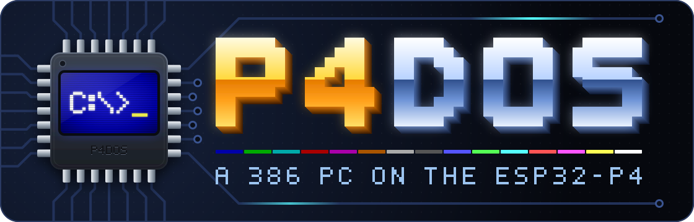
</h1>

FreeDOS on a 10.1" ESP32-P4 panel. The firmware emulates an IBM-compatible PC (80386DX,
80387, VGA, Sound Blaster compatible sound) in portable C and boots an unmodified FreeDOS 1.3 from the
board's flash. The panel is the monitor, a USB keyboard on the middle USB-C port is the
keyboard, the TF card is drive D:.

<p align="center">
  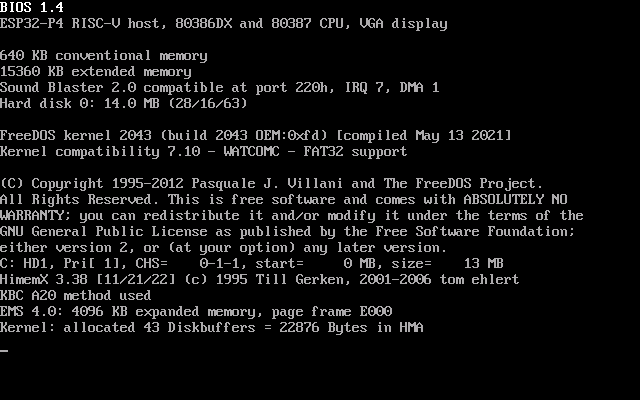
</p>

| | |
|---|---|
| Board | Guition JC8012P4A1C-I-W-Y: ESP32-P4 rev v1.3 (two RISC-V cores at 360 MHz) or, on newer boards, v3.x (400 MHz; run on v3.2), 32 MB PSRAM, 16 MB flash, 800x1280 MIPI-DSI panel. Hardware reference: [guition.md](guition.md) |
| Guest | 80386DX + 80387 with 16 MB, VGA, Sound Blaster 2.0 compatible sound, serial mouse; an 80186 or 8086 can be selected instead |
| System | stock FreeDOS 1.3 (kernel 2043, FreeCOM 0.85a), HIMEMX, EMS 4.0, CTMOUSE, CWSDPMI, DOS/32A |
| Speed | about 7 to 9 million x86 instructions per second for 16-bit code (where a 386DX-33 is), 4 to 6 for a 32-bit DOS-extender game |
| Boot | about 4 s from power-on to `C:\>` |
| Firmware | 0.82 MB; emulator core about 14,200 lines of C, the same code on Linux, on bare-metal RISC-V under QEMU and on the board |
| Version | 1.4, MIT licence |
| Guides | [Installation](docs/installation.md) · [User manual](docs/user-manual.md) · [Hardware reference](guition.md) |

**Contents:** [Screenshots](#screenshots) · [The machine DOS sees](#the-machine-dos-sees) ·
[Design](#design) · [CPU](#cpu) · [Memory](#memory) · [Display](#display) ·
[Time, storage, sound, USB](#time-storage-sound-usb) · [Performance](#performance) ·
[Build and try it on Linux](#build-and-try-it-on-linux) ·
[Firmware for the board](#firmware-for-the-board) · [Verification](#verification) ·
[Status on hardware](#status-on-hardware) · [Layout](#layout) · [Licences](#licences)

## Screenshots

Taken by the Linux build through the renderer the panel uses (the rotated 800x1280 frame
buffer, turned upright again), shown at half size. They are not photographs of the board.

<p align="center">
  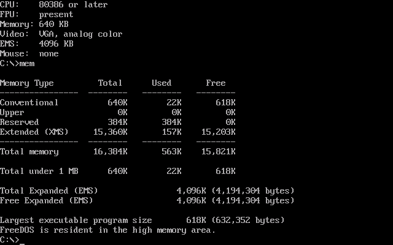
  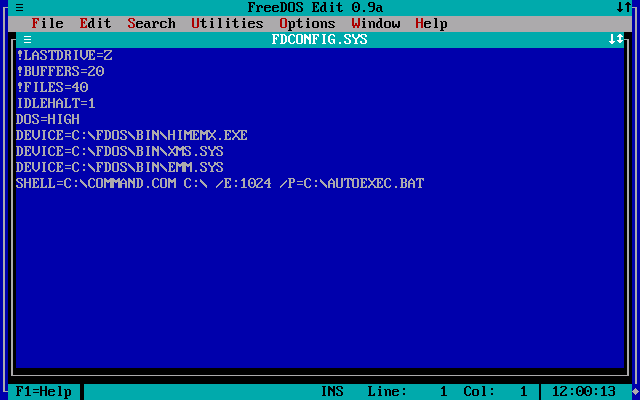
</p>
<p align="center">
  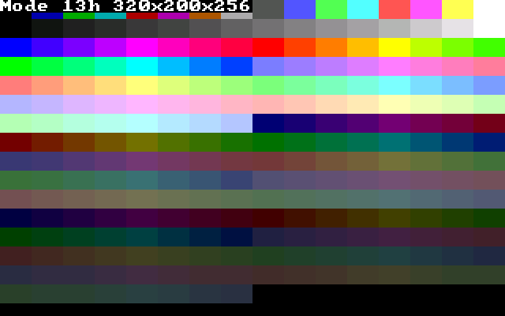
  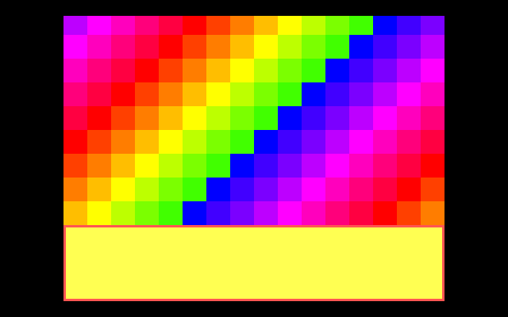
</p>

Left to right, top to bottom: `SYSINFO` and `MEM` on the default machine; FreeDOS `EDIT`
in 80x25 text; the BIOS 256-colour mode 13h; register-programmed "Mode X" (320x240,
unchained, with a split screen), which is shown 3x and centred.

## The machine DOS sees

| | |
|---|---|
| CPU | 80386DX: 32-bit registers and addressing, real, protected and virtual-8086 mode, paging, privilege levels, call/interrupt/task gates, task switches. An 80186 or 8086 can be selected instead |
| FPU | 80387: 80-bit registers, all rounding and precision modes, exceptions (reported on IRQ 13 as in a PC), `FSAVE`/`FRSTOR` in all four formats. Arithmetic is exact; the transcendental functions (`FSIN`, `FPATAN`, `FYL2X`, ...) are computed to double precision |
| Memory | 16 MB: 640 KB conventional (618 KB free, DOS loads high) and 15 MB extended behind an A20 gate, handed out as XMS by `HIMEMX`. EMS 4.0 from `EMM.SYS` (4 MB, page frame E000), or from `JEMM386` |
| Video | VGA: text 40/80x25, CGA modes, 16-colour modes 0Dh/0Eh/10h/12h, 640x480x2, 320x200x256, and register-programmed unchained 256-colour modes ("Mode X", split screen, hardware scrolling) |
| Screen | 1280x800: text and 200-line modes scale by exact integers (80x25 uses an 8x16 font doubled); 320x240 is shown 3x, centred |
| Keyboard | USB HID keyboard, wired, behind a hub or through a Logitech Unifying receiver; 101-key BIOS support, typematic, LEDs |
| Mouse | USB mouse (also through the Unifying receiver) presented as a Microsoft serial mouse on COM1 (`CTMOUSE` is loaded at boot) |
| Disks | C: 14 MB in on-board flash; D: is the TF card itself (FAT16 or FAT32) |
| Sound | Sound Blaster 2.0 compatible (port 220h, IRQ 7, DMA 1; `BLASTER=A220 I7 D1 T3`): 8-bit digital sound; PC speaker. Played through the board's ES8311 codec; volume on Ctrl+Alt+Up / Ctrl+Alt+Down |
| Clock | RX8025T RTC when fitted with a cell, otherwise a software clock |
| Other | two PICs (nothing on the second), PIT (18.2 Hz tick, reprogrammable), keyboard port with the A20 gate, port 92h, CMOS clock and memory size, LPT1/COM1 BIOS stubs |

Not emulated: 486 instructions, hardware breakpoints (the debug registers are only
storage), FM music (AdLib/OPL2: pick "Sound Blaster" for digital sound, music that needs
AdLib stays silent), ADPCM-compressed Sound Blaster playback, VGA text-mode font loading
and 43/50-line text, floppy/hard disk controller ports (disk access is through INT 13h
only).

Display and timer timing follow the machine clock to a fraction of a scan line: the status
register's retrace bits and one-shot timer interrupts line up, which demo-style code that
synchronises to the raster depends on.

## Design

The ESP32-P4 is a RISC-V chip, so x86 is emulated. The operating system is stock FreeDOS,
running on an emulated PC whose BIOS is part of the firmware.

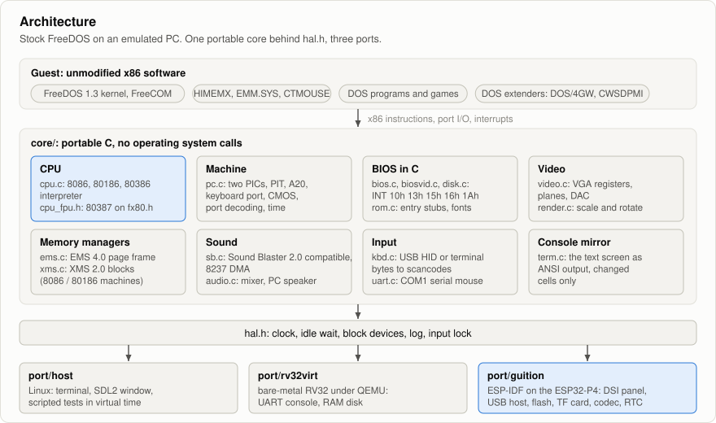

- **A PC with an 80386DX.** It started as a PC/XT-class machine with an 80186: FreeDOS
  ships an 8086 kernel, its base utilities run on an 8086/186, and a real-mode-only CPU is
  small and can be verified exhaustively. The 80386 came later, in the same interpreter:
  16-bit real-mode code still takes the path it always took, and the 8086 and 80186 remain
  as models that can be selected (and as a way to keep testing that path against the 8088
  suite). With the 80386 the machine gained what an AT has that 386 software expects:
  extended memory, the A20 gate, a second interrupt controller, CMOS.
- **VGA display.** 80x25 text with an 8x16 font is 640x400; doubled it is exactly the
  panel's 1280x800, and 320x200 quadruples to the same size. The adapter started out as an
  MCGA (just those modes); it became a VGA when the first real game put on the board,
  Pinball Fantasies, turned out to reprogram the CRTC for 320x240 with hardware scrolling
  and a split screen.
- **BIOS implemented in C.** The ROM (`bios/bios.asm`) holds only entry stubs at the
  classic IBM addresses, fonts and tables. Each stub executes `F1 nn`, an opcode the CPU
  core treats as a call into the emulator while CS = F000h. Services (INT 10h, 13h, 16h,
  1Ah, ...) then run as native RISC-V code instead of emulated x86, which is where a text
  mode DOS system spends much of its time. Hardware interrupts still go through the
  emulated PIC and real x86 stubs, so programs hooking INT 8/9/1Ch/15h behave as on a PC.
- **One portable core, three ports.** The board cannot be emulated on Linux (no QEMU model
  of the P4), so everything except the drivers lives in `core/` behind `hal.h` and is
  exercised on Linux, natively and as RISC-V code.


On the board the two cores are split by job:

| Core | Tasks |
|---|---|
| 1 | the emulator: interpreter and device models. It does not yield while the guest is busy and sleeps when the guest idles |
| 0 | display refresh (every 25 ms), USB host (library and HID events), serial console, sound output (I2S to the ES8311) |

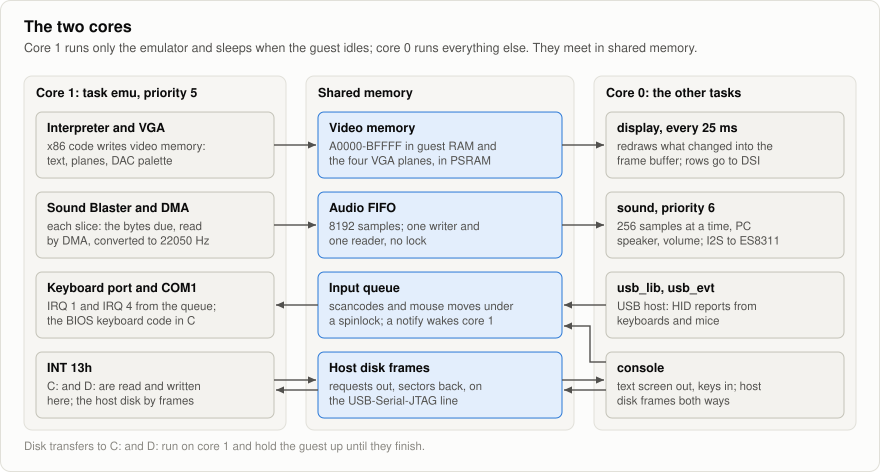


## CPU


`cpu_run(n)` executes up to *n* instructions. Arithmetic flags are kept lazily (the last
result and its carry vector) and materialised only when read. Interrupts are sampled only
at points where their deliverability can change (end of a slice, port output,
STI/POPF/IRET, HLT), so the hot loop has no per-instruction interrupt check. MOV SS/POP SS
and STI delay recognition by one instruction, as on the real chip.

**Dispatch.** The interpreter is one function of labelled handlers, one per opcode, each
ending with the dispatch of the next instruction (computed goto). Handlers that depend on
the operand size are compiled twice from `cpu_ops.h`, those that also use the stack four
times from `cpu_stk.h` (16- or 32-bit operands, SP or ESP), and there is a table of
handlers for each combination: the code and stack segments pick the table, an operand-size
prefix picks the other one for one instruction. Nothing in a 16-bit handler tests for
32-bit operation. An operand-size prefix (66h), frequent in 32-bit code, does not go
through the general prefix machinery when it is the only prefix: its handler dispatches
the instruction from the other operand-size table directly.

**Memory operands.** Memory goes through the segment register's cached descriptor
(`cpu_seg_t`), which carries a *window*: a range of offsets that are plain RAM at a known
host address. One unsigned compare covers the segment limit and "can this be done right
here"; everything else (limit violations, ROM, video memory, the A20 wrap-around, and all
of paging) is in out-of-line code, which is also where the 80386's faults are raised.
Instruction bytes come from a similar window on the code segment. Effective addresses are
formed from a table indexed by the ModRM byte, one table for 16-bit and one for 32-bit
addressing, so that both use the same code.


**Protected mode.** Faults abandon the instruction with `longjmp` to `cpu_run()`, which
enters the handler through the interrupt machinery of `cpu_sys.h` (gates, privilege
changes with their stack switch, task switches) and resumes. Instructions are written to
change the stack pointer only after their last access that can fault, so a restarted
instruction finds what it left. The paging unit is a 256-entry direct-mapped TLB in front
of a page walk that maintains the accessed and dirty bits; with paging on, memory operands
take the slow path (code is still fetched through a per-page window), which makes programs
under EMM386 or a paging DPMI host slower than real-mode ones.

**Built for the ESP32-P4.** Its core does not predict indirect jumps and pays for every
taken branch, so the function is compiled with `-fno-reorder-blocks` and written so that
the common case is the fall-through one; and words are read and written with single
unaligned loads and stores, which need a `-mtune` that allows them.

**Idle.** `HLT`, and BIOS calls that wait (INT 16h AH=0, INT 15h AH=86h), park the CPU
until the next interrupt, and a program spinning on "key available?" is parked after 64
empty polls per timer tick. So does the call Windows makes when it has nothing to do
(INT 2Fh AX=1689h): the CPU waits for the next interrupt, then makes the call. The
emulator task then sleeps, which is what lets the board idle at a DOS prompt (FreeDOS is
configured with `IDLEHALT=1`) and at the Windows desktop.

### 80387

The coprocessor (`cpu_fpu.h`) sits on `fx80.h`, 80-bit floating point done with integer
arithmetic: the ESP32-P4's own FPU is single precision, so the host's doubles would be
software too, and only a real 64-bit significand gets things like `FILD`/`FISTP` of 64-bit
integers and Turbo Pascal's `Extended` right. Add, subtract, multiply, divide, square
root, remainder, rounding and all conversions are exact and rounded as the control word
says, with the chip's exception flags and masked responses. The transcendental functions
go through the C library's `double` routines and are good to 53 bits. An unmasked
exception raises IRQ 13 through the second interrupt controller; the BIOS's INT 75h passes
it on to INT 2, where programs written for the 8087 expect it.

That generality costs some 400 RISC-V instructions per coprocessor instruction, and a
32-bit game spends an eighth of its instructions there. So there is a **fast path** in
front of it, for what programs do nearly all the time: every exception masked, operands
and results that are normal numbers or zero.

- The escape handlers in `cpu.c` do the most frequent instructions inline: loads and
  stores of 32- and 64-bit reals and integers, `FXCH`, the arithmetic with a register or a
  32- or 64-bit real, comparisons, `FNSTSW AX`.
- `fpu_fast()` handles a few more, with an add/subtract/multiply/divide core written for
  32-bit registers (`fpu_fast_op`), in every rounding mode and precision.
- Anything unusual is declined before it has changed anything and goes to the general
  code. The results are the same bit for bit, flags and instruction pointers included,
  which `tests/fpu_fast_test.c` checks by running random states through both.

Two things it has to cope with came from a real game: the Watcom C library copies memory
with `FILD`/`FISTP` of 64-bit integers, with rounding set to truncate, and the copy that
matters goes to the screen, below the window of a flat segment.

## Memory

### The guest's address space

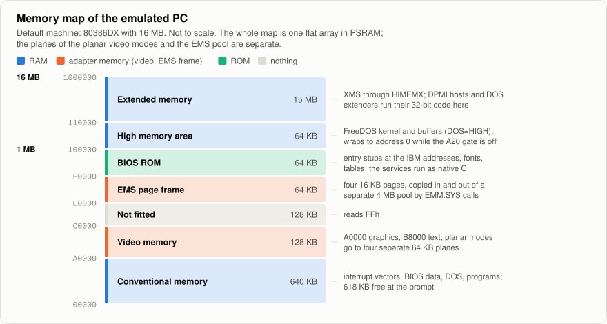

| Range | Size | What |
|---|---|---|
| `000000`-`09FFFF` | 640 KB | conventional memory; 618 KB free at the prompt, because the kernel and its buffers are in the high memory area |
| `0A0000`-`0BFFFF` | 128 KB | video memory. Text, CGA and chained 256-colour pictures live here; while a planar mode is active, accesses are routed to four separate 64 KB planes |
| `0C0000`-`0DFFFF` | 128 KB | not fitted, reads FFh (there is no video ROM: INT 10h is part of the BIOS) |
| `0E0000`-`0EFFFF` | 64 KB | EMS page frame: four 16 KB pages |
| `0F0000`-`0FFFFF` | 64 KB | BIOS ROM: entry stubs, fonts, tables |
| `100000`-`10FFEF` | 64 KB | high memory area, reachable while the A20 gate is on |
| `110000`-`FFFFFF` | 15 MB | extended memory: XMS, DPMI, DOS extenders |

The whole map is one flat array (16 MB by default, 1 to 24 MB selectable). The CPU reaches
it through the segment windows described above, so an ordinary load or store is one
compare and one host access; whatever is not plain RAM at that moment (ROM, the video
range while a planar mode is active, addresses that wrap with A20 off, anything behind
paging) falls out of the window and is handled out of line.

- **Extended memory** is part of the array. `HIMEMX` hands it out as XMS (15,360 KB) and
  switches A20 through the keyboard controller; DPMI hosts and DOS extenders run their
  32-bit code there.
- **Expanded memory** is a separate pool (4 MB by default). `EMM.SYS` forwards INT 67h to
  the emulator; because guest memory is one flat array, mapping a page copies it into the
  frame and copies the page it displaces back out. `JEMM386` can be loaded instead and
  provides EMS by paging, with DOS in virtual-8086 mode (slower).
- **On the 8086 and 80186 machines** there is no memory above 1 MB. `XMS.SYS` then offers
  XMS blocks from a pool of host memory, which is enough for FreeCOM to swap itself out.

### The board's memory


**PSRAM, 32 MB** (HEX mode, 200 MHz, data only):

| Use | Size |
|---|---|
| Guest RAM | 16 MB (`P4DOS_RAM_MB`; if PSRAM cannot give it, the machine gets 4 MB less until it fits) |
| EMS pool | 4 MB (`P4DOS_EMS_KB`; 8 MB by default on the 8086/80186 machines) |
| Frame buffer | 2 MB: 800x1280 RGB565, the panel driver's own, drawn into directly |
| VGA planes | 256 KB |
| Renderer | 64 KB: its shadow of the graphics screen (the planar modes use it for their tables) |
| Unallocated | about 9.7 MB: heap, USB transfer buffers |

Nothing is executed from PSRAM: it carries the frame buffer, and instruction fetches from
it break the picture up into lines. Guest RAM is ordinary data next to the frame buffer,
as in the board's reference firmware; if the picture ever shows line glitches under load,
that is the first thing to look at.

**Flash, 16 MB:**

| Offset | Size | Content |
|---|---|---|
| `0x002000` | | bootloader |
| `0x008000` | | partition table |
| `0x009000` | 24 KB | NVS (the volume setting) |
| `0x010000` | 1.94 MB | firmware slot; the image is 0.82 MB |
| `0x200000` | 14 MB | `dosdisk`: the hard disk image DOS sees as C:, read and written in place |

**Internal RAM and code placement** (from the linked firmware):

| | Size | Where |
|---|---|---|
| Code | 562 KB | flash, executed through the cache. The interpreter's `run_loop` is 127 KB of it, the general coprocessor code 10 KB, its fast path 8 KB |
| Constants | 181 KB | flash; 64 KB is the BIOS ROM image |
| Code in internal RAM | 82 KB | ESP-IDF's own (interrupt handling, flash driver) |
| Static data | 136 KB | internal RAM: a 32 KB disk transfer buffer, the 16 KB audio FIFO, the host disk's 16 KB of frame buffers, the 8 KB map of written video memory, the text shadow, ESP-IDF. The renderer's 64 KB is in PSRAM (see above) |

The L2 cache is 256 KB with 128-byte lines. On this chip revision (below v3) only 179 KB
of internal RAM is executable, and most of it is taken by the 82 KB above and by data, so
the interpreter cannot be moved out of flash; see [Performance](#performance).

## Display

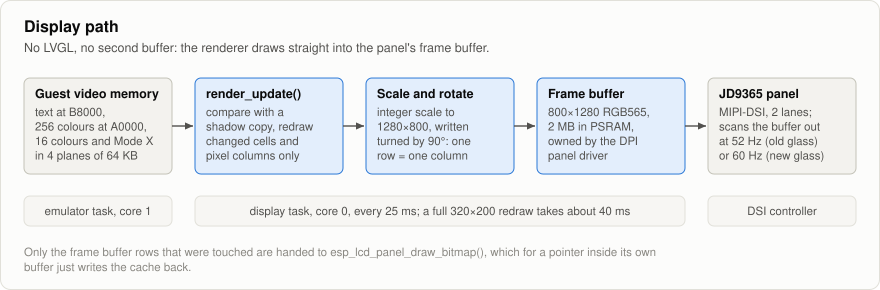

Text, CGA and chained 256-colour pictures live in ordinary guest memory. The planar modes
(16 colours, and "unchained" 256 colours) use four 64 KB planes with the VGA's write modes
and latches; while one is active the CPU core routes accesses at A0000h and above through
the machine layer (one compare per memory access, otherwise RAM is touched directly).
Picture geometry in those modes comes from the registers the program set: width, rows,
double scanning, start address, row pitch, line compare (split screen).

`render_update()` compares video memory with a shadow copy and redraws only changed text
cells or pixel columns, directly into the DPI frame buffer in PSRAM. In the planar modes
the VGA's write path marks every byte offset it writes in a bitmap, and the renderer
redraws, per byte column, only the rows between the first and the last that changed:
Windows moving its pointer costs a few dozen columns, not the 2 MB of a whole picture.
The glass is 800x1280 portrait, so the renderer writes pre-rotated: one frame buffer row
is one picture column (`fb(x, y) = screen(y, 799 - x)`, the orientation of the reference
firmware; `ROT_CCW` is the other way up). It returns the range of frame buffer rows
touched; the display task passes exactly those lines to `esp_lcd_panel_draw_bitmap()`,
which for a pointer inside its own frame buffer only writes the cache back. No LVGL, no
second buffer, no PPA: the P4's pixel-processing accelerator scales bilinearly, which
would blur the pixels.

<p align="center">
  
  &nbsp;&nbsp;
  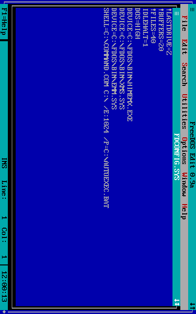
</p>

The same screen as DOS draws it and as it lies in the frame buffer.

| Mode | Source | Scale | Result |
|---|---|---|---|
| 80x25 text | 640x400 | 2 x 2 | 1280x800 |
| 40x25 text | 320x400 | 4 x 2 | 1280x800 |
| 4, 5, 13h | 320x200 | 4 x 4 | 1280x800 |
| 6 | 640x200 | 2 x 4 | 1280x800 |
| 11h, 12h | 640x480 | 2 x 5/3 | 1280x800 (nearest line) |
| 10h | 640x350 | 2 x 2 | 1280x700, centred |
| Mode X | 320x240 | 3 x 3 | 960x720, centred (square pixels) |

## Time, storage, sound, USB

**Time.** All device timing derives from the platform's monotonic clock: IRQ 0 at the
programmed PIT rate (missed ticks are caught up, up to 250 ms), PIT counter reads, the
display's horizontal and vertical blanking in the status register (from the programmed
CRTC timing, 31.47 kHz lines), typematic. The CPU runs as fast as the host allows. For
tests, a virtual clock advances with every instruction instead, making runs deterministic.

Timer interrupts are delivered on time, not at the end of a 4096-instruction slice: the
run loop shortens the slice so that it ends at the deadline (in real time it approaches
the deadline in shrinking steps, and the board's idle wait spins for the last 2 ms instead
of sleeping a whole RTOS tick). Raster-synchronised code needs this: Pinball Fantasies
counts displayed scan lines between a vertical retrace and a one-shot timer interrupt and
will not start until ten such measurements hit its target exactly.

**Storage.** `disk.c` implements INT 13h over a `blkdev_t` per drive. On the board:

- **C:** the raw `dosdisk` flash partition (14 MB). Sector writes go through an 8-block
  write-back cache of 4 KB flash blocks. On commit a block is skipped if unchanged,
  written without erase if only 1->0 bit changes are needed (the image's free space is
  0xFF for this reason), otherwise erased and rewritten. Commit happens when the guest
  idles and at least every 0.5 s. There is no wear levelling.
- **D:** the TF card as a raw disk: DOS reads the partition table and the FAT16/FAT32 file
  system itself, through the INT 13h LBA extensions for anything beyond the CHS range. The
  card is probed at start-up and again at every POST, so a card inserted before
  Ctrl+Alt+Del appears and a removed one disappears. A failed transfer restarts the card
  and is tried again: on the 4-bit bus at 20 MHz, then on the 1-bit bus (D0 only) at 20,
  then 5 MHz. A card that still refuses writes becomes read-only, so that DOS reports "write
  protected" at once instead of stalling. On the v3.2 board, writes on the 4-bit bus fail
  with CRC errors at any clock while reads work, and the 1-bit bus takes them: the first
  write after start-up falls back, and the card then runs at a quarter of the speed.
  Optionally (`P4DOS_SD_IMAGES`) the firmware mounts the card instead and attaches image
  files from it through FATFS.
- **Host disk:** a third hard disk whose sectors live in an image file on the PC at the
  other end of the serial console (`hostdisk.c`, served by `tools/hostdisk.py`). Requests
  and answers travel on the console line as frames (`ESC _ H D`, type, sequence number,
  length, payload, CRC-32) between the terminal output and the keystrokes; 16 sectors per
  frame, one request in flight, a lost frame is asked for again after 2 s, and after three
  silences the drive reports errors instead of hanging DOS. The PC speaks first, so a
  plain terminal never sees a frame. BIOS drive numbers have no gaps: the host disk is
  82h with a TF card and 81h without.


**Sound.** `sb.c` is a Sound Blaster 2.0 compatible DSP with the 8237 DMA registers it is
driven through. It plays in emulated time: whenever time has passed, the bytes due at the
programmed rate are fetched through DMA channel 1 (single-cycle, auto-init, or direct DAC
writes), converted to the fixed 22050 Hz output rate and pushed into a lock-free FIFO;
block ends raise IRQ 7 and the DMA position is readable, which mixers poll. `audio.c` adds
the PC speaker square wave on the consumer side, buffers 45 ms before (re)starting so that
the producer's millisecond-sized bursts never underrun, and applies the master volume. The
consumer is the SDL callback on Linux and, on the board, a task writing to the ES8311
codec over I2S. There is no FM synthesiser.


**USB.** The board has three USB-C ports. The firmware uses two of them, and any of the
three powers the board (they share its 5 V input).


| Port | Hardware | Used for |
|---|---|---|
| Upper | USB-Serial-JTAG, built into the P4, full speed | flashing, the firmware log, the DOS serial console, the host disk |
| Middle | USB 2.0 high-speed OTG, run as host, 5 V out | keyboards and mice: directly, behind a hub, or through a Logitech Unifying receiver |
| Lower | CH340 USB-UART bridge on UART0 | nothing |

- **Keyboard and mouse (middle port).** ESP-IDF's USB host library and HID class driver
  run on core 0, with hubs supported. Each keyboard and mouse interface is switched to the
  boot protocol; a Unifying receiver whose mouse stays in report protocol is understood as
  well, and its HID++ channel is ignored. Devices can come and go at any time. A keyboard
  report is compared with the previous one and turned into XT make and break codes
  (`kbd_hid_report`), with the typematic repeat generated there, since USB keyboards do not
  repeat; the codes reach DOS through the keyboard port and IRQ 1, the ROM's INT 9 stub,
  INT 15h/4Fh, and the C translator that keeps the BIOS buffer and shift flags. The
  keyboard LEDs follow Num, Caps and Scroll Lock. Ctrl+Alt+Up and Ctrl+Alt+Down set the
  volume and never reach DOS. A mouse drives an emulated 8250 UART on COM1 (3F8h, IRQ 4)
  speaking the Microsoft serial mouse protocol, so the stock `CTMOUSE` provides INT 33h;
  that serial mouse is always there, so a mouse plugged in later works without reloading
  the driver.
- **Serial console (upper port).** No driver is needed on the PC: the port appears as
  `/dev/ttyACM0` on Linux or as a COM port on Windows, and the baud rate setting does not
  matter. The firmware mirrors the text screen to an ANSI terminal, sending only cells that
  changed and code page 437 as Unicode (in graphics modes a line names the mode), and parses
  the terminal's keys into the same scancodes as a USB keyboard's: escape sequences for
  cursor and function keys, Alt+key as ESC followed by the key, Ctrl-L to repaint. The
  Linux and QEMU builds do the same with their terminals. Once the console runs, the
  firmware log is kept to warnings and errors, plus a line when a USB device comes or goes
  or the volume changes. The line also carries the host disk's frames between the screen
  output and the keys (see Storage). Only one program can have the port open, and opening it
  can reset the board.

**Board resources:**

| Board resource | Use | Trust in guition.md |
|---|---|---|
| ESP32-P4 core 1 | emulator task | Verified |
| ESP32-P4 core 0 | display refresh, USB host, serial console, sound | Verified |
| PSRAM 32 MB | guest RAM, EMS pool, frame buffer, VGA planes | Verified |
| Flash 16 MB | firmware at 0x10000, C: image at 0x200000 | Verified |
| JD9365 panel, GPIO27 reset, GPIO23 backlight, LDO 3 @ 2.5 V | display; the vendor's timings and init sequence for the old or the new glass | Verified |
| USB HS OTG (middle port) | keyboard and mouse | Verified |
| USB-Serial-JTAG (upper port) | flashing, log, DOS serial console, host disk | Verified |
| TF slot GPIO39-44, LDO 4 | drive D: | Verified (writes on the 1-bit bus on the v3.2 board) |
| RX8025T on I2C GPIO7/8 (0x32) | BIOS clock | Verified |
| ES8311 codec (I2C 0x18), I2S GPIO9/10/12/13, amplifier enable GPIO20 | Sound Blaster and PC speaker output | codec on I2C: Verified; I2S, amplifier and speaker: Vendor |
| ESP32-C6, touch, microphone, camera, RGB LED, battery sense | unused | - |

Settings taken from the "Known-good settings" table of guition.md: chip revision < 3.0
line (the v3.x build replaces it, see below), 16 MB QIO 80 MHz flash, HEX PSRAM at
200 MHz with nothing executed from it, L2 cache 256 KB / 128 B lines, USB host DMA memory
in PSRAM. Deliberate differences: the console is
the USB-Serial-JTAG port alone (it carries keyboard input), `-O2`, a 1 kHz tick, and no
idle watchdog on core 1 (the emulator does not yield while the guest is busy).

## Performance

### On the board

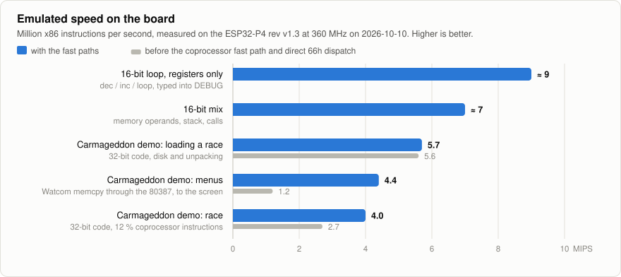

| Workload | Emulated MIPS | Before the fast paths |
|---|---|---|
| 16-bit loop, registers only (`dec`/`inc`/`loop` typed into DEBUG) | about 9 | |
| 16-bit mix: memory operands, stack, calls | about 7 | |
| Carmageddon demo, loading a race | 5.7 | 5.6 |
| Carmageddon demo, menus | 4.4 | 1.2 |
| Carmageddon demo, race | 4.0 | 2.7 |

Measured on the board (ESP32-P4 rev v1.3 at 360 MHz) on 2026-10-10; the game figures come
from the firmware's speed report (`P4DOS_STATS`) with keys sent over the serial console.
For 16-bit code this is where a 386DX-33 is. The Carmageddon demo (DOS/4GW, Watcom C,
BRender, coprocessor) runs, but its race shows one or two frames per second: the game
wants a Pentium, roughly ten times what is there.

### What an instruction costs

The board runs the interpreter at about 1.3 to 1.45 clock cycles per RISC-V instruction,
so RISC-V instruction counts predict its speed well, and they can be counted exactly under
`qemu-system-riscv32 -icount shift=0`. For 16-bit code (`make bench-rv32`, the instruction
mixes of `SPEED.COM`):

| Mix | RISC-V instructions per x86 instruction |
|---|---|
| register arithmetic | 32.8 |
| memory: loads, stores, read-modify-write | 55.0 |
| stack: push/pop, near call/return | 26.4 |
| branch: compares and conditional jumps | 27.3 |
| byte registers and immediates | 33.5 |
| average | 35.0 |

At 360 MHz that average is 7 to 8 MIPS, which is what the board shows. For 32-bit flat
code and the coprocessor:

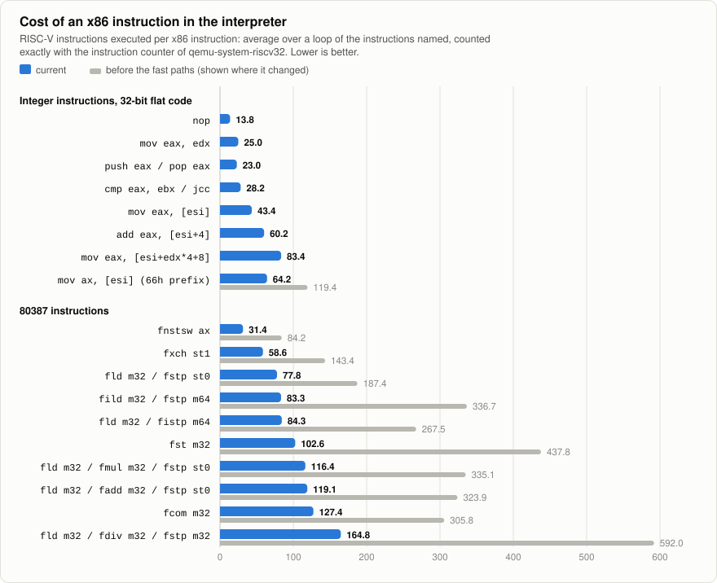

Each row is the average over a loop of the instructions named (eight copies of a single
one) together with its `dec ecx` / `jnz`.

| Loop | Now | Before |
|---|---|---|
| `nop` | 13.8 | |
| `mov eax, edx` | 25.0 | |
| `push eax` / `pop eax` | 23.0 | |
| `cmp eax, ebx` / `jcc` | 28.2 | |
| `mov eax, [esi]` | 43.4 | |
| `add eax, [esi+4]` | 60.2 | |
| `mov eax, [esi+edx*4+8]` | 83.4 | 84.2 |
| `mov ax, [esi]` (66h prefix) | 64.2 | 119.4 |
| `fnstsw ax` | 31.4 | 84.2 |
| `fxch st1` | 58.6 | 143.4 |
| `fld m32` / `fstp st0` | 77.8 | 187.4 |
| `fild m32` / `fstp m64` | 83.3 | 336.7 |
| `fld m32` / `fistp m64` | 84.3 | 267.5 |
| `fst m32` | 102.6 | 437.8 |
| `fld m32` / `fmul m32` / `fstp st0` | 116.4 | 335.1 |
| `fld m32` / `fadd m32` / `fstp st0` | 119.1 | 323.9 |
| `fcom m32` | 127.4 | 305.8 |
| `fld m32` / `fdiv m32` / `fstp m32` | 164.8 | 592.0 |

Shortcuts for segment register loads and far transfers (a cache of data segment loads,
skipping the reload of a register that seems to hold the same segment) were taken out
again on 2026-10-16: the second sent Descent 2 into a triple fault when its DOS extender
went to virtual-8086 mode with SS unchanged.

### Where the time goes

A profile of the Carmageddon race: 12 % of its instructions are coprocessor instructions
(mostly with 32-bit memory operands), 20 % address memory as `[disp32]`, 7 % use a SIB
byte, 3 % carry an operand-size prefix.

What paid:

- the coprocessor fast path: those 12 % cost about 400 RISC-V instructions each before;
- noticing that the menus were slow because the Watcom C library copies memory with
  `FILD`/`FISTP` of 64-bit integers, under a truncating control word, to the screen;
- dispatching a lone 66h prefix directly.

What did not, on this board:

- **The interpreter in internal RAM.** Chip revisions below v3 have 179 KB of executable
  internal RAM, of which ESP-IDF's code uses 82 KB; `run_loop` alone is 127 KB. It does
  not link.
- **A 512 KB L2 cache.** On this revision the cache comes out of a block of internal RAM
  that also holds data, and at 512 KB nothing of that block is left.
- **64-byte L2 cache lines.** No measurable difference.
- **The display.** A full 320x200 redraw takes the display task about 40 ms, nearly all of
  it writing 2 MB to the PSRAM frame buffer, but that is on the other core: stopping the
  refresh altogether gains the emulator 3 %.

What is left is the interpreter's fixed work per instruction: fetch and dispatch, and
some twenty RISC-V instructions to decode a memory operand. Getting well beyond this would
take translating blocks of guest code ahead of time (a decoded-instruction cache or a
JIT).

### Measuring

- `SPEED` at the DOS prompt runs 16-bit instruction mixes (register, memory, stack,
  branch) for a second each and prints thousands of instructions per second.
- `make bench-rv32` counts RISC-V instructions per x86 instruction for the same mixes, on
  the 80386 model the board runs.
- The firmware option `P4DOS_STATS` logs every two seconds how many million
  instructions per second the guest ran, how long the display refresh took, and where the
  guest spent its time (code segment and address, sampled at 1 kHz). With it, Ctrl-^
  followed by two hex digits on the serial console sends that scancode as it is, so that a
  key can be held down, and Ctrl-^ D stops and restarts the display refresh.

## Build and try it on Linux

Needs `gcc`, `make`, `python3`, `nasm`, `mtools`; optional `libsdl2-dev`.

```sh
make                 # build/p4dos, the host emulator
make image           # build/p4dos-hd.img and build/p4dos-floppy.img (downloads FreeDOS 1.3)
cp build/p4dos-hd.img my.img
build/p4dos -c my.img                 # interactive, in the terminal; Ctrl-] quits
make sdl && build/p4dos-sdl --sdl -c my.img --mouse   # 1280x800 window, as on the panel
make test            # scripted regression tests (headless, deterministic)
make cputest         # 8086 against SingleStepTests/8088 (downloads 730 MB)
make cputest386      # 80386 against SingleStepTests/80386, real mode (downloads 600 MB)
make test386         # 80386 against test386.asm: protected mode, paging, V86, tasks
make fputest         # 80387 arithmetic against the x87 of this PC (x86 hosts only),
                     # and the coprocessor's fast path against that arithmetic
```

`build/p4dos --help` lists the options (`-a/-b` floppies, `-c/-d` hard disks, `--cpu`,
`--fpu`, `--ram`, `--ems`, ...). `--script FILE` runs a session headless in virtual time;
its `shot FILE.png` command saves the picture through the panel's rendering path, which is
how the screenshots above were made.

### As RISC-V code under QEMU

```sh
make rv32            # bare-metal RV32IMAC build with the Espressif (or any riscv) GCC
make run-rv32        # FreeDOS on the serial console of qemu-system-riscv32 -M virt
make test-rv32       # the same, scripted
make bench-rv32      # RISC-V instructions the interpreter needs per x86 instruction
```

## Firmware for the board

Needs ESP-IDF 5.5.x, which fetches `espressif/usb_host_hid` and `espressif/esp_codec_dev`.
Step by step, with flashing a new board: [docs/installation.md](docs/installation.md).
`build.sh` uses the project's
own copy in `toolchain/` (ESP-IDF 5.5.4, its tools in `toolchain/espressif`) when it is
there, and otherwise the one `IDF_PATH` points to.

```sh
port/guition/build.sh                # builds the disk image if needed, then the firmware
P4DOS_REV3=1 port/guition/build.sh   # the same for boards with chip revision v3.x
```

Result: `port/guition/build/p4dos.bin` plus bootloader and partition table (`build-rev3/`
for v3.x). A build for revisions below v3.0 does not start on a v3.x chip, nor the other
way round; check with `esptool flash_id`. The v3.x build also selects the second
generation of the glass (`P4DOS_LCD_NEW_PANEL`), which the board with a v3.2 chip has.
Flashing (upper USB-C port, "USB JTAG/serial debug unit") writes the firmware **and the
FreeDOS disk image, replacing what is on C:**:

```sh
port/guition/build.sh -p /dev/ttyACM0 flash monitor
```

To update the firmware and keep C: as it is, write only the application (from
`build-rev3/` for a v3.x chip):

```sh
python -m esptool --chip esp32p4 -p /dev/ttyACM0 write_flash 0x10000 port/guition/build/p4dos.bin
```

Options are under "P4DOS" in `build.sh menuconfig`: processor (80386DX, 80186, 8086),
coprocessor and memory size, flip the picture 180° (`P4DOS_ROTATE_180`), the glass
generation, EMS size, serial console, TF card, and a speed report on the log for
benchmarking (`P4DOS_STATS`).

### Using it

In short; the [user manual](docs/user-manual.md) has the details.

- **Keyboard and mouse:** on the middle USB-C port, through a USB-C to USB-A OTG adapter
  (see [USB](#time-storage-sound-usb)). Ctrl+Alt+Del reboots DOS, also when a program has
  hung.
- **Volume:** Ctrl+Alt+Up and Ctrl+Alt+Down, in ten steps from silent to full, each
  confirmed by a short beep. DOS never sees these two key combinations. The setting is
  remembered across power cycles (it starts at 60 %).
- **Serial console:** any ANSI terminal on the upper USB-C port, e.g.
  `picocom /dev/ttyACM0` or `screen /dev/ttyACM0`, shows the text screen and types into
  it, so the machine is usable without panel or keyboard. Close it before flashing or
  starting `tools/hostdisk.py`: they need the same port.
- **TF card = drive D:** an ordinary FAT16 or FAT32 card (with a partition table, as cards
  are sold; not exFAT) is used directly by DOS, so files move between a PC and the board
  on the card. Insert it before power-on, or press Ctrl+Alt+Del after inserting or
  changing it: DOS only looks for drives when it boots. Do not pull the card while DOS is
  writing. Long file names show in their short form (`LONGFI~1.TXT`).
  With `P4DOS_SD_IMAGES` in menuconfig the card instead holds disk image files:
  `/P4DOS/A.IMG`, `/P4DOS/B.IMG` (floppies, booted in preference to C:) and
  `/P4DOS/HD.IMG` (D:). `build/p4dos-floppy.img` is a rescue floppy with FDISK, FORMAT
  and SYS.
- **Getting files in over USB:** `python3 tools/hostdisk.py DIRECTORY` (needs pyserial and
  mtools) packs the directory into a disk image and serves it through the serial console:
  DOS reboots and has it as one more drive, E: with a TF card in the slot and D: without,
  read-only; copy with `COPY` or `XCOPY`. The terminal stays the DOS screen, Ctrl-] ends.
  With a disk image instead of a directory (one with a partition table, such as
  `build/p4dos-hd.img`) the drive is writable, and files copied to it are in the image
  afterwards (`mcopy -i IMAGE@@32256 ::FILE .`).
- **Getting files in, other ways:** on the TF card (D:). Or into the C: image with mtools
  before flashing it, e.g. `mcopy -i build/p4dos-hd.img@@32256 GAME.EXE ::`, or build
  the image with extra content: `python3 tools/mkimage.py --add path/to/dir`. C: of a
  board in use can be read out (`esptool read_flash 0x200000 0xE00000 c.img`), changed the
  same way and written back to `0x200000`.
- **Protected-mode programs:** `CONFIG.SYS` loads `HIMEMX`, so programs get extended
  memory through XMS. For DPMI programs (DJGPP and the like) `CWSDPMI.EXE` is in
  `C:\FDOS\BIN`: such programs start it by themselves, `CWSDPMI -p` keeps it loaded.
  `tests/dos/dpmitest.asm` (`nasm -f bin -o DPMITEST.COM`, then copied over) is a quick
  check that 32-bit protected mode works this way. `DOS32A.EXE`
  (for DOS/4GW-style executables: `DOS32A PROGRAM.EXE`) and `JEMM386.EXE` (for programs
  that want EMM386; it puts DOS into virtual-8086 mode, which is slower: load it instead
  of `EMM.SYS`, not together with it) are there as well. Tried so far: the CWSDPMI test, a
  boot under JEMM386, and one DOS/4GW game (the Carmageddon demo).
- **Windows 3.1x:** installs with its own Setup from a directory holding the files of the
  installation disks and runs in standard mode (`WIN`). For this the `HIMEMX.EXE` of the
  image differs from the FreeDOS one in one byte (`patch_himemx` in `tools/mkimage.py`):
  releasing an A20 lock while FreeDOS still holds its own reports success, as Microsoft's
  HIMEM does; otherwise Windows refuses to start. Two things do not work, here or with the
  same installation under QEMU (there with Microsoft's HIMEM.SYS): 386 enhanced mode
  (`WIN /3` stops during start-up) and starting a DOS program from inside Windows, which
  crashes: leave Windows first. Tried in the host emulator with Windows 3.11: Setup in
  batch mode, Program Manager, Notepad, Solitaire, File Manager, mouse, exit to DOS; on
  the board: start and exit of the installation made there.
- **Power off:** wait a second after the last disk write; C: is written back to flash when
  DOS goes idle.

## Verification

| What | How | Result |
|---|---|---|
| 8086 instruction set incl. undocumented flags | SingleStepTests/8088 v2 on the 8086 model (`make cputest`) | all 3,007,000 pass |
| 80386 instruction set, real mode, 16- and 32-bit operands and addressing | SingleStepTests/80386, captured from a 386EX (`make cputest386`) | 1,758,677 of 1,758,700 pass. The rest: reads of the test chip's own I/O ports (6), instructions that overwrite themselves and rely on the prefetch queue (4), an IDIV overflow quirk (9), the flags AAM leaves when it divides by zero (4) |
| 80386 protected mode: privilege levels, gates, paging and its faults, virtual-8086 mode, task switches, 16/32-bit stacks | test386.asm as the machine's ROM (`make test386`) | reaches POST code FFh with and without the checks of undefined behaviour; its 44,926 lines of arithmetic results equal the reference from a real 80386 |
| 80387 arithmetic: add, subtract, multiply, divide, square root, remainders, rounding, scaling, comparisons, conversions to and from single, double and integers | `make fputest`: random and special operands in every rounding mode and precision, against the x87 unit of the PC the test runs on | 38,000,000 operations, results and exception flags identical |
| 80387 fast path | `make fputest`, second part (`tests/fpu_fast_test.c`): every escape opcode from random coprocessor states (all rounding and precision modes, special operands, flat and 16-bit segments), run as an instruction and by the general code | 20,000,000 instructions per run, same registers, status, pointers and memory; deliberately broken fast paths are caught within a few thousand |
| 80387 instructions | `tests/dos/fputest.asm` in FreeDOS (part of `make test`): exact results, every operand-order encoding, transcendental functions within 1e-15, stack fault, FSAVE/FRSTOR, an unmasked exception through IRQ 13 | pass, in the emulator and on the board |
| 80186 additions | self-checking `tests/dos/t186.asm` on the 80186 model; its expectations agree with qemu-system-i386 | pass |
| BIOS, video, disk, keyboard, memory managers, sound, mouse | `make test`: 25 scripted FreeDOS sessions (boot, file I/O compared with mtools, EDIT, DEBUG, graphics modes, mode 12h and Mode X with split screen (redrawn as the board's display task does, only what changed, and compared with the whole picture drawn afresh), raster/timer timing, EMS, XMS, HIMEMX with DOS high, the A20 probe of Windows 3.1, a 32-bit DPMI program under CWSDPMI, DOS in virtual-8086 mode under JEMM386, Sound Blaster DMA playback and the volume shortcut checked in the recorded audio, CTMOUSE, floppy boot + FORMAT, a 10 GB FAT32 card image as D:, a host disk read and written through the console line, Ctrl+Alt+Del, the coprocessor and a machine without one, the 80186 and 8086 models, each greeted with the name of its processor) | pass |
| A real game | Pinball Fantasies demo (Mode X, raster-calibrated timer, Sound Blaster music): intro, menu, table, ball in play | worked in the host emulator with the 80186 core (screenshots, continuous audio in the recording); not repeated since |
| A 32-bit game | Carmageddon demo (DOS/4GW, Watcom C, BRender, coprocessor, Sound Blaster) | host emulator: registration card, menus, race loading, grid, the race itself (screenshots); the same 2.8 billion instructions end in the same CPU state and picture with and without the coprocessor fast path. On the board: see [Performance](#performance) |
| Disk image | also boots on qemu-system-i386 (SeaBIOS) | checked with the first image; not repeated since HIMEMX was added |
| Same C code as RISC-V | `make test-rv32`: FreeDOS on the 80386 to the prompt, commands, file write under qemu-system-riscv32 | pass |
| Panel rendering path | screenshots taken through the rotated 800x1280 path | checked by eye |
| Board firmware | flashed 2026-10-10, driven over the serial console | FreeDOS boots with HIMEMX and DOS high; `DPMITEST` runs a 32-bit protected-mode program and `FPUTEST` passes; C: writes survive a reset |

Of 32-bit software, only what this file names has been run: test programs under CWSDPMI
and JEMM386, one DOS extender game (the Carmageddon demo), and Windows 3.11 in standard
mode.

## Status on hardware

Two boards have run it. On the first (ESP32-P4 rev v1.3, the old glass), checked through
the serial console and the firmware log:

- boot, PSRAM, the emulator and FreeDOS up to the prompt, with the 80386, 16 MB of memory,
  `HIMEMX` and DOS loaded high;
- a 32-bit protected-mode program under CWSDPMI (`DPMITEST`) and a DOS/4GW game started
  from the TF card;
- the coprocessor (`FPUTEST`: arithmetic, transcendental functions, state save and
  restore, an unmasked exception arriving as IRQ 13);
- drive C: in flash, including writes that survive a reset (`CHKDSK` clean);
- the TF card (7.5 GB) as D:, and reports from a USB keyboard on the middle port;
- the host disk: with `tools/hostdisk.py` serving a packed directory, DOS has it as E:
  next to the card; `XCOPY` of 200 files (8.3 MB) from it to the card took 102 s and
  `COMP` found every file identical;
- Windows 3.11 in standard mode from `D:\WIN`, brought over that way: `WIN` reaches
  640x480 in 16 colours and stays there, Alt+F4 and Enter return to the DOS prompt;
- RX8025T clock: read, set from DOS (`DATE`, `TIME`), keeps time across resets;
- the JD9365 answers on DSI; the ES8311 codec answers on I2C and opens at 22050 Hz.

On the second (rev v3.2 at 400 MHz, the new glass), in use since 2026-10-15: the picture
on the panel, confirmed by its user; boot to the prompt with the same C: and TF card; a
keyboard through a Unifying receiver; Norton Commander and Windows 3.11, whose exits write
to D:, return to DOS cleanly since the TF card falls back to the 1-bit bus (see Storage).
The planar redraw of only what changed and the quicker VGA write modes (2026-10-14) run
there under Windows.

Not confirmed by measurement, because they need ears at the board or have not been tried:
sound from the speaker connector (`P4DOS_VOLUME` sets how loud 100 % is) and a USB mouse.

## Layout

| Path | |
|---|---|
| `core/` | portable emulator: CPU (`cpu.c` with `cpu_sys.h`, `cpu_ops.h`, `cpu_stk.h`; the 80387 in `cpu_fpu.h` on `fx80.h`), machine, BIOS services, video renderer, disk, host disk, keyboard, EMS, XMS, Sound Blaster |
| `bios/` | BIOS ROM stubs (NASM) and fonts; assembled into `core/rom.c` (`make rom`) |
| `dosfiles/` | CONFIG/AUTOEXEC, the MBR, `EMM.SYS`, `XMS.SYS`, `SPEED.COM` and `WELCOME.COM` (the greeting, naming the emulated processor) sources |
| `tools/` | disk image builder, font and ROM generators, host disk server |
| `port/host/` | Linux port: terminal, scripted test mode, SDL window |
| `port/rv32virt/` | bare-metal RISC-V port for QEMU `virt` |
| `port/guition/` | ESP-IDF project for the board |
| `tests/` | CPU and coprocessor conformance runners, DOS-level regression tests, RISC-V boot test and benchmark |
| `docs/` | [installation guide](docs/installation.md), [user manual](docs/user-manual.md) |
| `docs/img/` | the figures and screenshots of this file; the banner (`logo.svg`) and the icon (`icon.svg`, and `icon.png` at 512x512 for a repository avatar) |
| `guition.md` | hardware reference for the board |

The BIOS ROM starts with the signature `GDOSBIOS`, which `EMM.SYS` and `XMS.SYS` look for
before they talk to the emulator. The volume setting is stored in the NVS namespace `gdos`.

## Licences

- P4DOS itself, including the logo, figures and screenshots in `docs/img`: MIT, see
  [`LICENSE`](LICENSE).
- Sound Blaster is a trademark of Creative Technology Ltd. P4DOS emulates a compatible
  card and is not affiliated with Creative. FreeDOS, ESP32, Windows and the other product
  names mentioned here are trademarks of their owners; P4DOS is not affiliated with or
  endorsed by them.
- FreeDOS kernel, FreeCOM and utilities, HIMEMX, JEMM386, CWSDPMI and DOS/32A: downloaded
  from the FreeDOS 1.3 repository by `tools/mkimage.py` (HIMEMX with the one-byte change
  described under "Using it"); GPL and other free licences, sources at freedos.org. They
  are not part of this tree. A built disk image contains them, so whoever passes one on
  passes on their licences and sources with it.
- The board firmware links ESP-IDF and the components `espressif/usb_host_hid` and
  `espressif/esp_codec_dev`, fetched at build time (Apache-2.0; ESP-IDF contains parts under
  other free licences, such as FreeRTOS under MIT). A built `p4dos.bin` carries them, so
  whoever passes one on includes their notices.
- The CPU test suites (SingleStepTests/8088 and /80386, test386.asm) are downloaded by
  the test scripts and are not part of this tree.
- `bios/font8x*.bin`: the public-domain CP437 fonts shipped with SeaBIOS
  (`vgasrc/vgafonts.c`), extracted by `tools/mkfont.py`. `bios/vgapal.bin`, the VGA's
  default palette, is built by the same script from the palette's structure.
- `port/guition/components/esp_lcd_jd9365`, and the panel initialisation tables in
  `port/guition/main/jd9365_init*.h`, which come from the vendor's examples: Espressif,
  Apache-2.0.
