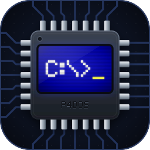

# Guition JC8012P4A1C-I-W-Y — hardware reference

A 10.1" touch panel built around an ESP32-P4, with an ESP32-C6 on board for Wi-Fi and
Bluetooth. Written as a starting point for new firmware projects on this board, from the
vendor's documents and from two firmwares run on it: P4DOS (this repository) and an
earlier firmware with LVGL, touch, Wi-Fi and BLE, which is not part of this repository.

How far to trust each item:

- **Verified** — exercised on the board by P4DOS (display, USB host, USB-Serial-JTAG,
  flash, PSRAM, TF card, RTC, the codec's I2C interface).
- **Verified (earlier firmware)** — exercised by the earlier firmware only (touch, Wi-Fi,
  BLE, rotation with the PPA); P4DOS does not use them.
- **Vendor** — read from the vendor's schematic, spec sheet or demo code, never exercised
  (sound output, microphone, RGB LED, camera, battery, expansion headers).

## At a glance

| Item | Detail | Trust |
|---|---|---|
| Main MCU | ESP32-P4, dual-core RISC-V, revision v1.3, runs at 360 MHz (a later unit: v3.2 at 400 MHz) | Verified |
| PSRAM | 32 MB, in-package, 16-line (HEX) at 200 MHz | Verified |
| Flash | 16 MB NOR (Winbond W25Q128 on the v1.3 unit, BOYA on the v3.2 unit), QIO at 80 MHz | Verified |
| Internal memory | 768 KB HP L2MEM, 32 KB LP SRAM, 128 KB HP ROM | Vendor |
| Display | 10.1" IPS, 800x1280 (portrait glass), JD9365, MIPI-DSI 2 lanes | Verified |
| Touch | GSL3680 capacitive, I2C | Verified (earlier firmware) |
| Wireless | ESP32-C6 module over SDIO (ESP-Hosted): Wi-Fi 2.4 GHz + Bluetooth LE | Verified (earlier firmware) |
| USB | 3 x USB-C: serial/JTAG, high-speed OTG, CH340 UART bridge | Verified (CH340 port: Vendor) |
| Audio | ES8311 codec, NS4150 speaker amp, one analog MEMS microphone | codec on I2C: Verified; the rest: Vendor |
| Storage | TF (microSD) slot, 4-bit SDMMC | Verified (see TF card below) |
| RTC | RX8025T with CR1220 holder | Verified |
| Other | WS2812 RGB LED, MIPI-CSI camera connector, Li-battery charger (IP5306) | Vendor |
| Supply | 5 V, about 700 mA | Vendor |
| Size | 242.8 x 158.7 mm module, 216.58 x 135.36 mm active area, about 550 g | Vendor |

The ESP32-P4 has **no radio of its own**. Everything wireless goes through the C6.

## Processor and memory

- ESP32-P4 in QFN104, 40 MHz main crystal, 32.768 kHz crystal on GPIO0/GPIO1.
- The first unit is an early chip, **revision v1.3**. ESP-IDF 5.5 targets revision 3.0+ by
  default and its bootloader refuses to start on this chip unless the older line is
  selected (see "Known-good settings"). A later unit has **revision v3.2**; a build for one
  line does not start on the other.
- 360 MHz is the supported speed for revision v1.x. 400 MHz exists there only as an
  experimental override for chips Espressif has qualified; v3.x runs at 400 MHz.
- Both cores are used (FreeRTOS SMP).
- PSRAM carries the display framebuffer. Do not also execute code from PSRAM (no XIP): the
  fetches compete with the display scan-out and the picture breaks up into lines.
- Internal RAM that DMA can use is scarce once Wi-Fi, BLE, LVGL and USB are all running
  (earlier firmware).

## Display

| Parameter | Old glass (v1.3 unit) | New glass (v3.2 unit) |
|---|---|---|
| Panel | 10.1" IPS TFT, 16.7 M colours (HKC glass, JD9365DA-H3 controller) | same controller |
| Native resolution | 800 x 1280, portrait | same |
| Interface | MIPI-DSI, 2 data lanes, video (DPI) mode | same |
| Lane bit rate | 1500 Mbps | 840 Mbps |
| Pixel clock | **60 MHz** | **70 MHz** |
| Horizontal timing | back porch 20, sync 20, front porch 40 | same |
| Vertical timing | back porch 8, sync 4, front porch 20 | back porch 10, sync 4, front porch 30 |
| Refresh | about 52 Hz | about 60 Hz |
| Colour format used | RGB565 (16 bpp); the glass is 24-bit capable | same |
| Reset | GPIO27 | same |
| Backlight | GPIO23, active high, through an MP3202 LED boost driver | same |
| DSI PHY supply | P4 internal LDO channel 3 at 2500 mV — must be enabled in firmware | same |
| Connector | FPC1, 31-pin 0.3 mm | same |

- The generic JD9365 settings in ESP-IDF (70–80 MHz clock, other porches) do **not** work on
  the old glass: the image collapses into a corner with vertical stripes.
- The panel needs a board-specific init sequence. The vendor ships two generations, "Old
  panel" and "New panel". The v1.3 unit works with the 197-command **Old panel** sequence
  (`port/guition/main/jd9365_init.h`); the New panel one did not work on it.
- The v3.2 unit has the **New panel**: with the Old panel sequence it shows only a light
  screen with horizontal lines. It works with the 204-command New panel sequence and
  timing of the vendor's ESP-IDF 5.5.4 example (`1-Demo/IDF_5.5.4/JC8012P4A1C_I_W_Y_New_Panel`
  in the vendor package; here `port/guition/main/jd9365_init_new.h`). On v3.x the D-PHY
  PLL reference must be ESP-IDF's default (`phy_clk_src = 0`): the JD9365 macro's
  PLL_F20M does not exist there and aborts the DSI bus setup.
- For landscape (1280x800), P4DOS draws into the frame buffer pre-rotated (see the README,
  "Display"). The earlier firmware rotated with the P4's PPA hardware (LVGL port option
  below): LVGL's software rotation left tearing lines, and the DSI `avoid_tearing` /
  `full_refresh` modes crash when combined with rotation.
- The backlight pin can be PWM-dimmed (Vendor); P4DOS only switches it on and off.

## Touch (earlier firmware)

- GSL3680 capacitive controller, I2C address 0x40, 400 kHz.
- SDA GPIO7, SCL GPIO8, interrupt GPIO21, reset GPIO22. Connector FPC2, 6-pin.
- The board has external pull-ups on this bus. Keep the MCU's internal pull-ups **off**, or
  the controller mis-reads.
- The chip needs its configuration loaded at start-up, which the earlier firmware's
  GSL3680 driver does (that driver is not part of this repository).
- Multi-touch works (5 points configured there).
- Coordinates are in the native portrait frame; for a landscape picture rotated as the
  earlier firmware did, mirror X.

## Wireless: the ESP32-C6 (earlier firmware)

| Parameter | Value |
|---|---|
| Module | ESP32-C6 (Wi-Fi 6 on 2.4 GHz, Bluetooth LE 5, 802.15.4) |
| Link to the P4 | SDIO, 4-bit, 40 MHz, SDMMC slot 1 |
| SDIO pins (P4 side) | CLK GPIO18, CMD GPIO19, D0 GPIO14, D1 GPIO15, D2 GPIO16, D3 GPIO17 |
| C6 enable / reset | P4 GPIO54 (reset is active high in the ESP-Hosted config) |
| Extra line | P4 GPIO6 to C6 IO2 (used by neither firmware) |
| Factory firmware | ESP-Hosted slave ("network_adapter") 2.3.2, built with ESP-IDF v5.5 |

- On the P4 use `esp_hosted` + `esp_wifi_remote`; the normal `esp_wifi_*` calls then work.
- **Bluetooth LE only.** The C6 has no Bluetooth Classic. Run a NimBLE host on the P4 with
  HCI tunnelled over ESP-Hosted (VHCI). No C6 reflash is needed for this.
- The factory C6 firmware allows **3 simultaneous BLE connections**. More needs the C6
  firmware rebuilt.
- Wi-Fi and BLE share one radio. With Wi-Fi power save off, Wi-Fi holds the radio for about
  30 ms of every 102.4 ms beacon period and BLE traffic arrives in lumps. Use
  `WIFI_PS_MIN_MODEM` whenever BLE is active.
- The C6 can be flashed directly through header CN5 (3V3, GND, C6 TX, C6 RX, C6 IO9, C6 EN)
  (Vendor). The vendor image is in the vendor package, under
  `8-Burn operation/Burn files/JC-C6-slave_v2.3.2.bin`.

## USB ports

All three are USB-C and all share the 5 V input rail, so any of them powers the board.

| Position | Function | P4 pins |
|---|---|---|
| Upper | USB-Serial-JTAG (full speed): flashing, console, debug | GPIO24 (D-), GPIO25 (D+) |
| Middle | USB 2.0 high-speed OTG; works as **host** with no board change | dedicated HS PHY pins |
| Lower | CH340C USB-UART bridge on UART0, with auto-reset/boot circuit | GPIO37 (TX), GPIO38 (RX) |

- A USB-A device on the middle port needs a USB-C to USB-A (female) OTG adapter.
- 5 V is present on the middle port whenever the board is powered.

## Audio

- ES8311 mono codec on the shared I2C bus (chip default address 0x18).
- I2S: MCLK GPIO13, BCLK GPIO12, LRCK/WS GPIO10, data to codec GPIO9, data from codec GPIO11.
- NS4150 class-D speaker amplifier, enable on GPIO20; speaker connector CN3.
- One analog MEMS microphone into the codec's MIC1 input.
- The vendor demos run it at 16 kHz, 16-bit. P4DOS opens it at 22050 Hz mono: the codec
  answers on I2C and opens (Verified); sound from the speaker has not been confirmed by ear.

## Other peripherals

- **TF card** (Verified): SDMMC 4-bit. D0 GPIO39, D1 GPIO40, D2 GPIO41, D3 GPIO42, CLK
  GPIO43, CMD GPIO44. The slot is powered from the P4's internal LDO channel 4, which must
  be enabled first. On the v1.3 unit the card reads and writes on the 4-bit bus at
  20 MHz. On the v3.2 unit, with the same card, reads and commands work but writes on the
  4-bit bus fail with CRC errors at any clock; the 1-bit bus (D0 only) takes them. The
  cause has not been found (a fault on D1–D3 in the host-to-card direction would explain
  it).
- **RTC** (Verified): RX8025T on the shared I2C bus (chip default address 0x32), CR1220
  backup cell. P4DOS reads and sets it; it keeps time across resets.
- **RGB LED** (Vendor): one WS2812 on GPIO26.
- **Camera** (Vendor): 2-lane MIPI-CSI connector (FPC5, 15-pin), control over the shared
  I2C bus. The vendor documents an OV02C10 sensor.
- **Battery** (Vendor): IP5306 charger and 5 V boost, Li-battery connector CN1, power key
  SW1. Battery voltage is on GPIO52 through a 68 k / 100 k divider. This SKU (-Y) ships
  without a battery; the -Y1 variant includes one.
- **Buttons** (Vendor): reset (chip enable), boot (GPIO35), power key (IP5306).

## Shared I2C bus

One bus, SDA GPIO7 and SCL GPIO8, carries everything:

| Device | Address | Trust |
|---|---|---|
| GSL3680 touch | 0x40 | Verified (earlier firmware) |
| ES8311 codec | 0x18 (chip default) | Verified |
| RX8025T RTC | 0x32 (chip default) | Verified |
| Camera connector, header CN4 | depends on what is attached | Vendor |

## GPIO map

| GPIO | Use | Trust |
|---|---|---|
| 0, 1 | 32.768 kHz crystal | Vendor |
| 2, 3, 4, 5 | free, on expansion connector FPC3 | Vendor |
| 6 | to C6 IO2 | Vendor |
| 7, 8 | I2C SDA, SCL (shared bus) | Verified |
| 9, 10, 11, 12, 13 | I2S: data out, LRCK, data in, BCLK, MCLK | Vendor |
| 14, 15, 16, 17 | SDIO D0–D3 to the C6 | Verified (earlier firmware) |
| 18, 19 | SDIO CLK, CMD to the C6 | Verified (earlier firmware) |
| 20 | speaker amplifier enable | Vendor |
| 21, 22 | touch interrupt, touch reset | Verified (earlier firmware) |
| 23 | display backlight | Verified |
| 24, 25 | USB-Serial-JTAG D-, D+ (upper USB-C) | Verified |
| 26 | WS2812 RGB LED | Vendor |
| 27 | display reset | Verified |
| 28–34 | free, on expansion connector FPC4 | Vendor |
| 35 | boot button / boot-mode strap | Vendor |
| 36 | pulled up (strap) | Vendor |
| 37, 38 | UART0 TX, RX (CH340 and header CN2) | Vendor |
| 39–42, 43, 44 | TF card D0–D3, CLK, CMD | Verified |
| 45, 46, 47, 48 | free, on expansion connector FPC3 | Vendor |
| 49, 50, 51, 53 | not identified | — |
| 52 | battery voltage sense | Vendor |
| 54 | C6 enable / reset | Verified (earlier firmware) |

Expansion connectors (Vendor): CN4 is a 4-pin I2C header (GND, 3V3, SCL, SDA). CN2 is a
4-pin power/UART header (5 V in, UART0 TX, UART0 RX, GND). FPC3 and FPC4 are 16-pin flat
cable connectors carrying the free GPIOs above plus the I2C bus and 3.3 V.

## Power (Vendor)

- 5 V in through any USB-C port or header CN2.
- IP5306 handles battery charging and the 5 V boost; a TLV62569 makes 3.3 V and a second one
  makes the P4 core supply.
- The P4's internal LDO channels feed the flash (1), the MIPI PHY (3) and the TF slot (4).

## Known-good settings (ESP-IDF 5.5.4)

These are the settings this board needed. P4DOS's are in `port/guition/sdkconfig.defaults`
(and `sdkconfig.defaults.rev3` for v3.x chips); the rows marked "earlier firmware" are for
LVGL, ESP-Hosted and BLE, which P4DOS does not use.

| Setting | Why |
|---|---|
| `CONFIG_ESP32P4_SELECTS_REV_LESS_V3=y`, `CONFIG_ESP32P4_REV_MIN_100=y` | chip revision v1.3; otherwise the bootloader refuses to start. A v3.x unit needs the opposite (`SELECTS_REV_LESS_V3=n`, minimum v3.1), and such a build does not start on v1.3 |
| `CONFIG_ESPTOOLPY_FLASHSIZE_16MB=y`, `FLASHMODE_QIO`, `FLASHFREQ_80M` | flash |
| `CONFIG_SPIRAM=y`, `CONFIG_SPIRAM_MODE_HEX=y`, `CONFIG_SPIRAM_SPEED_200M=y` | PSRAM |
| no `SPIRAM_XIP_FROM_PSRAM` / `FETCH_INSTRUCTIONS` / `RODATA` | code in PSRAM glitches the display |
| `CONFIG_SPIRAM_MALLOC_ALWAYSINTERNAL=1024`, `CONFIG_SPIRAM_MALLOC_RESERVE_INTERNAL=65536` | earlier firmware: keeps internal DMA memory free; ESP-Hosted's SDIO driver crashes when it runs out |
| `CONFIG_CACHE_L2_CACHE_256KB=y`, `CONFIG_CACHE_L2_CACHE_LINE_128B=y` | from the vendor reference |
| `CONFIG_LVGL_PORT_ENABLE_PPA=y` | earlier firmware: hardware rotation to landscape |
| `CONFIG_ESP_CONSOLE_UART_DEFAULT=y`, `CONFIG_ESP_CONSOLE_SECONDARY_USB_SERIAL_JTAG=y` | earlier firmware: logs on both the CH340 port and the serial/JTAG port. P4DOS uses `CONFIG_ESP_CONSOLE_USB_SERIAL_JTAG=y` alone, since its console carries keyboard input |
| `CONFIG_BT_ENABLED=y`, `CONFIG_BT_CONTROLLER_DISABLED=y`, `CONFIG_BT_NIMBLE_ENABLED=y`, `CONFIG_ESP_HOSTED_ENABLE_BT_NIMBLE=y`, `CONFIG_ESP_HOSTED_NIMBLE_HCI_VHCI=y` | earlier firmware: BLE through the C6 |
| `CONFIG_USB_HOST_DWC_DMA_CAP_MEMORY_IN_PSRAM=y` | USB host; otherwise endpoint allocation fails for lack of internal DMA memory |

Components: P4DOS uses `esp_lcd_jd9365` 1.0.2 (kept in `port/guition/components/`),
`espressif/usb_host_hid` and `espressif/esp_codec_dev`. The earlier firmware used
`espressif/esp_hosted` 2.11.7, `espressif/esp_wifi_remote` 1.6.5, `espressif/esp_lvgl_port`
2.8.0, LVGL 9.6.0, `esp_lcd_jd9365` 1.0.2 and a GSL3680 touch driver.

## Flashing and console

- Flash through the **upper** USB-C port. It appears as "Espressif USB JTAG/serial debug
  unit" (`/dev/ttyACM*` on Linux).
- `python -m esptool --chip esp32p4 -p <port> -b 460800 --before default_reset --after hard_reset write_flash @flash_args`
- On the serial/JTAG port the baud rate setting does not matter; a UART console on the CH340
  port runs at 115200 baud. The serial/JTAG console drops when the chip resets, so re-open
  the port after a reset.

## Source material

- The vendor's download package for the board (not part of this repository):
  `JC8012P4A1C_I_W_Y/` — spec sheet (`2-Specification`), schematic sheets
  (`5-Schematic`), panel init and chip data sheets (`4-Driver_IC_Data_Sheet`), demos
  (`1-Demo`), factory images (`8-Burn operation`).
- P4DOS's board support: `port/guition/main/` (`board.h` for the pins, `display.c`,
  `storage.c`, `sound.c`, `rtc.c`, `usbhid.c`, `console.c`).
- Build settings: `port/guition/sdkconfig.defaults` and `sdkconfig.defaults.rev3`.
